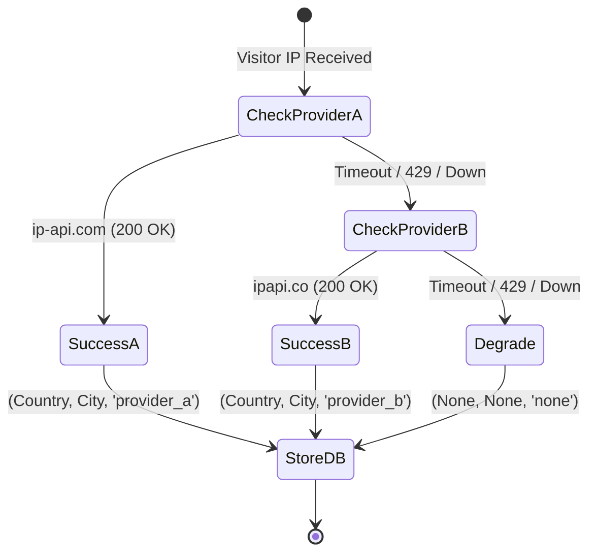
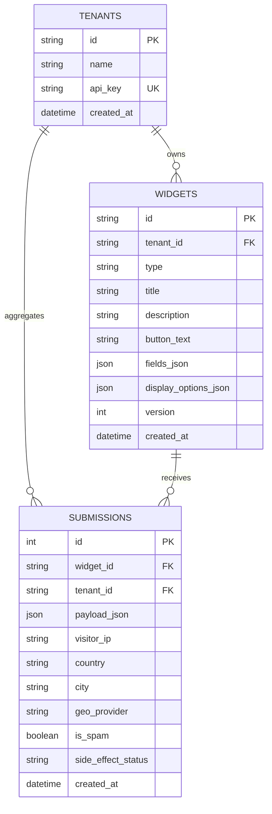

# FlyRank Architecture Design Document (DESIGN.md)

## 1. System Overview & Core Topology

The **FlyRank Embeddable Widget & Lead-Capture Platform** is engineered to provide high-performance, resilient, and multi-tenant lead capture infrastructure. It bridges three distinct operational planes:

1. **Tenant Admin Plane**: Authenticated CRUD and analytics for form creators.
2. **Edge Asset Plane**: Aggressively cached static JavaScript loader (`widget.v1.js`) and fast JSON config delivery.
3. **Public Ingest Plane**: Cross-origin form submission pipeline featuring strict size boundaries, sliding-window rate limiting, honeypot spam detection, dual-provider geolocation fallback, and fault-isolated secondary side effects.

```mermaid
flowchart TD
    subgraph Customer Site (Origin B)
        DOM["HTML Document"] -->|"1. Loads script"| JS["widget.v1.js"]
        JS -->|"2. Fetches config"| API_CFG["GET /widgets/:id/config"]
        DOM -->|"3. Submits form"| API_SUB["POST /submissions"]
    end

    subgraph FlyRank Platform (Origin A)
        API_CFG --> CACHE["HTTP Cache (max-age=60s)"]
        API_SUB --> MID_SIZE["Boundary Check (<= 64KB)"]
        MID_SIZE --> RL["Sliding-Window Rate Limiter"]
        RL --> HP{"Honeypot Filled?"}
        
        HP -->|Yes| SPAM["Flag is_spam=1 & Reject (400)"]
        HP -->|No| GEO["Geo Enrichment Fallback Chain"]
        
        GEO -->|Provider A| GEO_A["ip-api.com"]
        GEO -->|Fallback B| GEO_B["ipapi.co"]
        GEO -->|Degraded| GEO_NONE["None / 'none'"]

        GEO --> DB[(SQLite / Postgres Persistence)]
        DB --> SIDE_EFFECT["Safe Side Effect (Email Queued)"]
    end

    subgraph Tenant Dashboard
        DASH["GET /dashboard/stats"] --> DB
    end
```

---

## 2. Caching & Edge Delivery Strategy

To sustain high load while minimizing database round-trips:

| Asset / Endpoint | Cache-Control Header | Lifetime | Rationale |
| :--- | :--- | :--- | :--- |
| `widget.v1.js` | `public, max-age=31536000, immutable` | 1 Year | Script contains immutable client logic. Versioned URLs (`widget.v1.js`, `widget.v2.js`) ensure browser edge caches never re-fetch until an explicit version bump. |
| `/widgets/:id/config` | `public, max-age=60` | 60 Seconds | Form styling and fields update rarely. Short TTL ensures instant global caching while propagating tenant edits within 60 seconds. |
| `/submissions` | `no-store, no-cache` | 0 Seconds | Ingest endpoints must never be cached. Responses are dynamic and transactional. |

---

## 3. Ingest Pipeline Hardening & Abuse Protection

The public submission endpoint (`POST /submissions`) is open to the internet and protected by multiple defensive layers:

### A. Payload Boundary Protection
- Request headers and payload streams are inspected prior to parsing.
- Payloads exceeding **64KB** are rejected immediately with `413 Payload Too Large`.
- Malformed JSON structures or empty bodies return `422 Unprocessable Entity` or `400 Bad Request`, ensuring the server **never crashes with a 500 error**.

### B. In-Memory Sliding-Window Rate Limiting
- Tracks requests per client IP and per `widget_id`.
- Enforces a **maximum burst of 5 requests within 3 seconds** and **20 requests per 60 seconds**.
- Excess requests are rejected with `429 Too Many Requests` accompanied by a `Retry-After: <seconds>` header.

### C. Honeypot Anti-Spam Trap
- The client widget renders a hidden CSS trap field: `<input type="text" name="website_url_hp" class="flyrank-hp" />`.
- Human visitors cannot see or fill this field. Automated scrapers and bots blindly populate all text inputs.
- When `website_url_hp` is populated:
  - The submission is recorded in the database flagged as `is_spam = 1`.
  - Secondary side effects (emails, webhooks) are **completely suppressed**.
  - A clean `400 Bad Request` response is returned.

---

## 4. Geolocation Fallback Chain

IP resolution uses a resilient fallback chain designed to **never fail the primary submission**:



1. **Provider A (`ip-api.com`)**: Primary fast lookup.
2. **Provider B (`ipapi.co`)**: Secondary fallback if Provider A fails, times out, or returns an error.
3. **Graceful Degradation**: If both providers are offline, the record is stored with `country=None, city=None, geo_provider="none"`. The visitor receives an instant `201 Created`.

---

## 5. Fault-Tolerant Secondary Side Effects

Secondary integrations (email notifications, webhooks) are notoriously unreliable points of failure.
- In this platform, `trigger_confirmation_email()` is wrapped inside an execution sandbox.
- If SMTP servers are unreachable, DNS times out, or authentication fails:
  - The error is logged internally with structured severity.
  - The submission database record is updated with `side_effect_status = "failed"`.
  - The primary HTTP response **returns 201 Created to the user without interruption**.

---

## 6. Multi-Tenant Data Model & Isolation

### Relational Schema


### Isolation Guarantees
- All admin endpoints require `X-API-Key` or `Authorization: Bearer <key>`.
- The database queries enforce strict tenant scoping: `WHERE id = ? AND tenant_id = ?`.
- Tenant A cannot read, modify, or delete widgets belonging to Tenant B (returns `404 Not Found`).
- Dashboard metrics and analytics only aggregate rows matching the authenticated `tenant_id`.
- SQLite indexes on `idx_widgets_tenant`, `idx_submissions_tenant`, `idx_submissions_widget`, and `idx_submissions_created_at` guarantee optimal $O(\log N)$ query speed.
