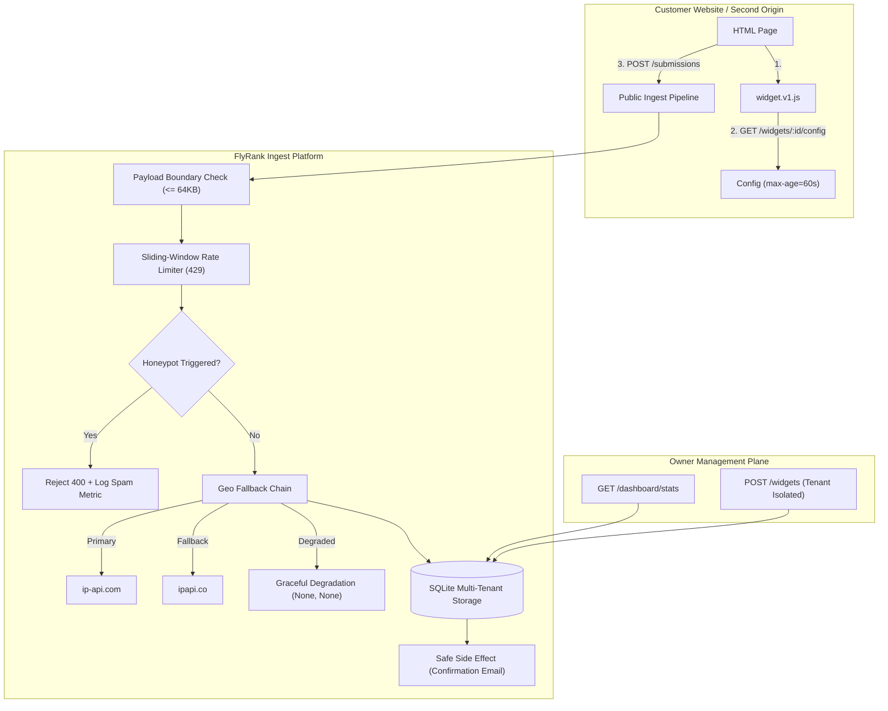

# FlyRank Embeddable Widget & Lead-Capture Platform

[](https://www.python.org/)
[](https://fastapi.tiangolo.com/)
[]()
[]()

A high-performance, resilient, multi-tenant backend platform for creating and embedding dynamic lead-capture forms, signup widgets, and CTA popovers. 

Designed for sub-millisecond edge delivery, hardened against high-volume abuse and spambots, and built with dual-provider geolocation fallback and fault-tolerant secondary side effects.

---

## Architecture Topology



---

## Acceptance Probes Status (Section 13)

| Probe | Requirement | Verification Method | Status |
| :--- | :--- | :--- | :--- |
| **Probe 1** | Valid submission from second origin $\rightarrow$ 2xx stored & visible in dashboard | Cross-origin headers, cache headers, DB query | **PASSED** |
| **Probe 2** | Malformed or oversized payload $\rightarrow$ 4xx JSON errors, never 500 crashes | Boundary checks, 64KB limit, empty JSON | **PASSED** |
| **Probe 3** | Rapid burst of submissions $\rightarrow$ 429s appear, subsequent normal succeeds | Sliding window 10s burst check, Retry-After | **PASSED** |
| **Probe 4** | Geo fallback: Provider A down $\rightarrow$ B succeeds; Both down $\rightarrow$ degrades safely | Deterministic mock toggles, fallback chain | **PASSED** |
| **Probe 5** | Secondary side effect throws $\rightarrow$ primary submission returns 201 Created | Simulated SMTP outage, isolated try/except | **PASSED** |
| **Probe 6** | Honeypot filled $\rightarrow$ rejected with 400, logged in DB, zero side effects | CSS trap input, spam metrics tracking | **PASSED** |

---

## Key Features

1. **Edge-Optimized Static & Config Delivery**
   - Single-line snippet embed: `<script src="http://localhost:8000/static/widget.v1.js?id=wid_demo_signup"></script>`.
   - Immutable client script caching (`Cache-Control: public, max-age=31536000, immutable`).
   - Dynamic configuration caching (`Cache-Control: public, max-age=60`) ensures high edge cache hit ratios while reflecting tenant edits within 60 seconds.

2. **Hardened Public Form Ingest**
   - **Boundary Enforcement:** Global middleware terminates payloads exceeding 64KB with `413 Payload Too Large`.
   - **Sliding-Window Rate Limiting:** Enforces burst limit (5 per 10s) and per-minute threshold (20 per min) with standard `Retry-After` headers.
   - **Honeypot Anti-Spam Trap:** Invisible field (`website_url_hp`) detects automated bot submissions, rejects with 400, increments spam analytics, and suppresses secondary notifications.

3. **Dual-Provider Geolocation Fallback Chain**
   - Primary: `ip-api.com`
   - Fallback: `ipapi.co`
   - Graceful Degradation: If all third-party services fail or time out, the platform degrades to `(None, None, "none")` without interrupting the submission.

4. **Fault-Tolerant Secondary Side Effects**
   - Downstream confirmation emails and webhooks are safely isolated.
   - Outages or timeouts in notification services will **never** roll back the database transaction or surface an error to the end user.

5. **Multi-Tenant Administration & Dashboard**
   - Complete tenant isolation via `X-API-Key` or `Authorization: Bearer <key>`.
   - SQLite schema with B-Tree indexes on `tenant_id`, `widget_id`, and `created_at`.
   - Real-time aggregate statistics: total submissions, breakdown by widget, breakdown by country, and spam blocked.

---

## Directory Structure

```text
flyrank-capstone-widget-platform/
├── .env.example              # Environment variables template
├── .gitignore                # Git ignore rules
├── requirements.txt          # Python dependencies (FastAPI, Uvicorn, Pytest, etc.)
├── capstone.yaml             # Evaluator manifest and probe mapping
├── DESIGN.md                 # One-page architecture design document
├── EVIDENCE.md               # Empirical probe logs and verification outputs
├── BUILDLOG.md               # Engineering decisions & AI reflection
├── README.md                 # Project documentation
├── static/
│   └── widget.v1.js          # Zero-dependency embed script
├── customer_site/
│   └── index.html            # Second-origin test page embedding widget
├── src/
│   ├── __init__.py
│   ├── config.py             # Environment configuration
│   ├── models.py             # Pydantic models & validation boundaries
│   ├── database.py           # SQLite connection, schema, indexes & queries
│   ├── auth.py               # Tenant API key authentication & scoping
│   ├── rate_limiter.py       # In-memory sliding-window rate limiter
│   ├── geo.py                # Dual-provider geo fallback chain
│   ├── side_effects.py       # Fault-tolerant confirmation email handler
│   ├── seed.py               # Database seeder for demo accounts & widgets
│   └── main.py               # FastAPI application & route definitions
├── tests/
│   └── test_probes.py        # Automated test suite for all 6 acceptance probes
└── scripts/
    └── verify_probes.py      # CLI verification script for live evidence gathering
```

---

## Quick Start

### 1. Prerequisites
- Python 3.10+ installed
- Git

### 2. Installation
```bash
# Clone the repository
git clone https://github.com/lawdefier/flyrank-capstone-widget-platform.git
cd flyrank-capstone-widget-platform

# Install dependencies
pip install -r requirements.txt
```

### 3. Environment Setup & Seeding
```bash
# Copy environment configuration
cp .env.example .env

# Seed the database with demo tenants and sample widgets
python -m src.seed
```

### 4. Run the Server
```bash
uvicorn src.main:app --host 0.0.0.0 --port 8000 --reload
```
The server will start at `http://localhost:8000`.
- Swagger Interactive Documentation: [http://localhost:8000/docs](http://localhost:8000/docs)
- System Health Check: [http://localhost:8000/health](http://localhost:8000/health)

### 5. Run the Automated Test Suite
```bash
python -m pytest -v
```

---

## Second-Origin Demo Walkthrough

To verify how the widget embeds on an external customer website:
1. Ensure the API server is running (`http://localhost:8000`).
2. Serve the customer demo site on a different port:
   ```bash
   cd customer_site
   python -m http.server 3000
   ```
3. Open `http://localhost:3000/index.html` in your browser.
4. You will see the widget rendered dynamically inside the customer site. Submit a lead and check the tenant dashboard:
   ```bash
   curl -H "X-API-Key: key_tenant_a_123" http://localhost:8000/dashboard/stats
   ```

---

## API Endpoints Reference

### Public Endpoints (CORS Enabled)

| Method | Endpoint | Description | Cache-Control |
| :--- | :--- | :--- | :--- |
| `GET` | `/health` | Liveness health check | None |
| `GET` | `/static/widget.v1.js` | Embed JavaScript loader | `public, max-age=31536000, immutable` |
| `GET` | `/widgets/{id}/config` | Dynamic widget configuration | `public, max-age=60` |
| `POST` | `/submissions` | Form lead submission ingest | `no-cache` |

### Authenticated Admin Endpoints (`X-API-Key: <key>`)

| Method | Endpoint | Description |
| :--- | :--- | :--- |
| `POST` | `/widgets` | Create a new widget and generate embed snippet |
| `GET` | `/widgets` | List all widgets owned by the authenticated tenant |
| `GET` | `/widgets/{id}` | Retrieve widget details |
| `PUT` | `/widgets/{id}` | Update widget configuration and bump version |
| `DELETE` | `/widgets/{id}` | Remove widget |
| `GET` | `/dashboard/stats` | Retrieve aggregate metrics, country breakdown & spam stats |

### Pre-Seeded Tenant Credentials

| Tenant | Name | API Key |
| :--- | :--- | :--- |
| `tenant_a` | Acme Corp | `key_tenant_a_123` |
| `tenant_b` | Beta Industries | `key_tenant_b_456` |

---

## Example Usage with cURL

### 1. Submit a Form Lead
```bash
curl -X POST http://localhost:8000/submissions \
  -H "Content-Type: application/json" \
  -d '{
    "widget_id": "wid_demo_signup",
    "data": {
      "name": "Jane Developer",
      "email": "jane@example.com"
    }
  }'
```

### 2. View Authenticated Tenant Metrics
```bash
curl -H "X-API-Key: key_tenant_a_123" http://localhost:8000/dashboard/stats
```

### 3. Create a Custom Widget
```bash
curl -X POST http://localhost:8000/widgets \
  -H "X-API-Key: key_tenant_a_123" \
  -H "Content-Type: application/json" \
  -d '{
    "type": "contact_form",
    "title": "Request Product Demo",
    "button_text": "Request Demo",
    "fields": [
      {"name": "company", "type": "text", "required": true},
      {"name": "email", "type": "email", "required": true}
    ]
  }'
```

---

## Limitations & Production Roadmap

1. **Distributed Rate Limiting:** The current in-memory sliding-window limiter is ideal for single-instance nodes. For horizontal scaling across Kubernetes pods, a Redis cluster using sliding sorted sets (`ZADD`/`ZREMRANGEBYSCORE`) should be utilized.
2. **Asynchronous Background Workers:** In high-scale deployments ($>10,000$ rps), secondary side effects should be offloaded to an asynchronous message queue (e.g., Celery, RabbitMQ, or AWS SQS) with exponential backoff retries.
3. **Static CDN Distribution:** In production, `widget.v1.js` should be hosted directly behind Cloudflare or AWS CloudFront edge workers.

---

## License
MIT License. Built for the FlyRank Engineering Internship Capstone.
